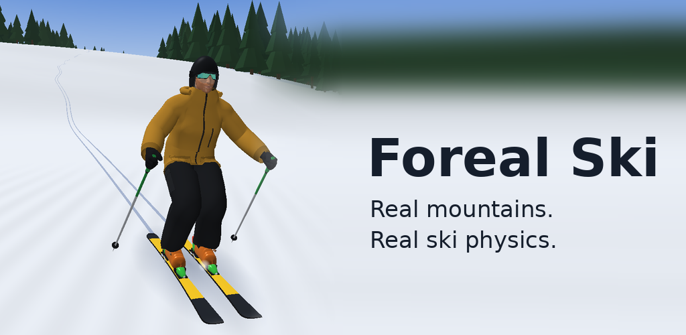
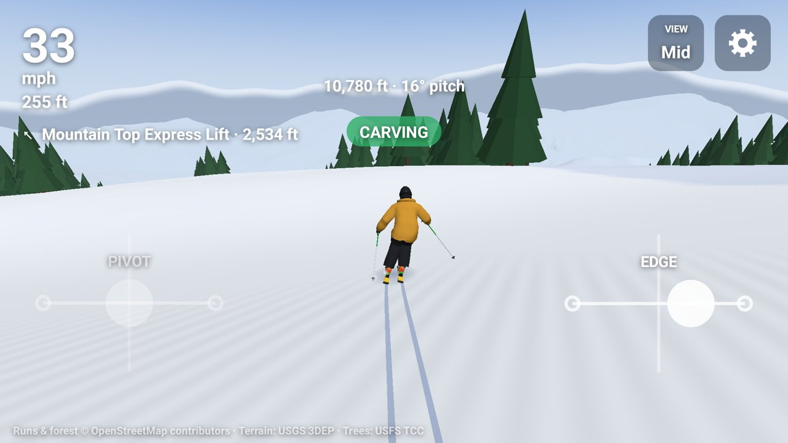
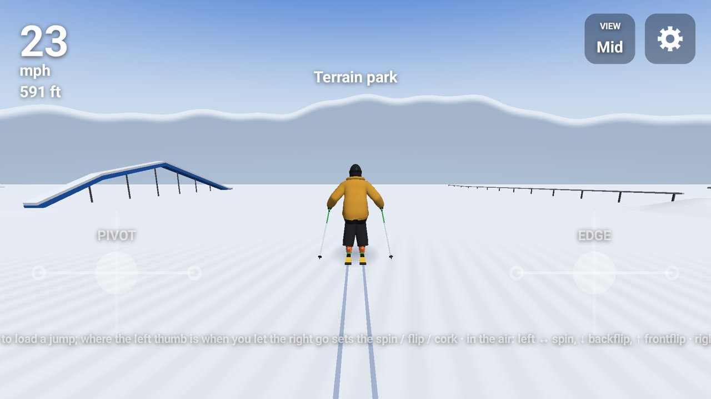
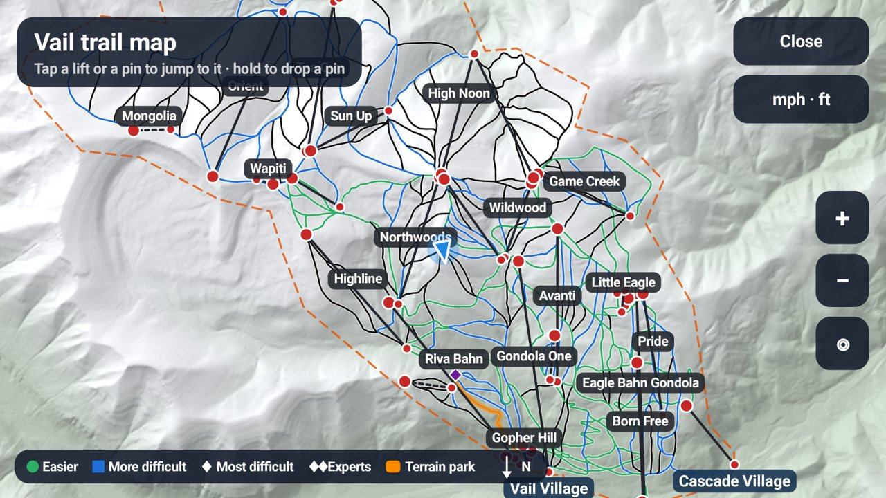

# Foreal Ski

A free skiing game for Android, set on real mountains. The terrain comes from public lidar
surveys, the runs, lifts and forests from OpenStreetMap, so the pitches, rollers, cliffs and
trees are where they really are. The skiing is physics, not animation: you carve on your edges,
skid, snowplow, skate and tuck, and the snow, the slope and your speed decide what happens.

| | |
| --- | --- |
|  |  |
|  | |

## What's in it

- **Real mountains** in the US and Canada, downloaded as you want them, each with its runs,
  lifts and trail map. Ask in the game for one that isn't there yet and it gets built.
- **Created content:** a terrain park (jumps, rails, a superpipe), a face of flat-topped cliffs,
  a long groomer, and Foreal, a hill that never ends.
- **Race courses:** slalom, giant slalom, super G and downhill, against the clock.
- **Tricks:** spins, flips, corks and a dozen grabs, rails and boxes.
- **Your rider:** build, skin, hair, beard, and gear from helmets and goggles to skis.
- No ads, nothing to buy. Sign in (optional) to keep your progress on every phone.

## Get it

Download the newest APK from [Releases](../../releases) and open it on your phone (Android 8 or
newer; you'll be asked to allow installing apps from your browser or file manager). The game
offers each new version itself after that. It's coming to Google Play too.

## Playing

Two thumbs. The **left** one twists your skis against the way you're going (a little to steer, a
lot for a hockey stop). The **right** one rolls them onto their edges to carve; push it up to
skate, pole or tuck, pull it back to snowplow. Both thumbs up loads a jump; let the right one go
to pop. In the air the left thumb spins and flips, the right one grabs. The hints along the
bottom of the screen say what's what wherever you are.

## Feedback, bugs and ideas

In the game, **⚙ › Feedback**: say whether it's a bug, an idea or a change, and what it is.
No account needed. It turns up here as an issue (your email, if you give one, only goes to the
developer, never here). You can also open an issue on this repo directly.

## Data and credits

Every real mountain in the game is built from open data. Thank you to everyone who collects and
shares it.

| What | Where it comes from | Licence |
| --- | --- | --- |
| Runs, lifts, forest areas and ski-area boundaries | © [OpenStreetMap](https://www.openstreetmap.org/copyright) contributors, read through the [Overpass API](https://overpass-api.de/) | [Open Database License (ODbL) 1.0](https://opendatacommons.org/licenses/odbl/) |
| Finding a mountain that's asked for | [Nominatim](https://nominatim.org/), OpenStreetMap's search | ODbL 1.0 (OpenStreetMap data) |
| Ground (the US): bare-earth lidar elevation | U.S. Geological Survey, [3D Elevation Program (3DEP)](https://www.usgs.gov/3d-elevation-program), via [The National Map](https://apps.nationalmap.gov/) | U.S. public domain |
| Trees (the US lower 48): how thick the forest is | USDA Forest Service, [Tree Canopy Cover (NLCD TCC)](https://data.fs.usda.gov/geodata/rastergateway/treecanopycover/) | Public data from the USDA Forest Service, credited here |
| Ground (Canada): lidar elevation | Natural Resources Canada, [High Resolution Digital Elevation Model (HRDEM), CanElevation Series](https://open.canada.ca/data/en/dataset/957782bf-847c-4644-a757-e383c0057995) | Contains information licensed under the [Open Government Licence – Canada](https://open.canada.ca/en/open-government-licence-canada) |
| Ground (Canada), where there's no lidar | Natural Resources Canada, [Medium Resolution Digital Elevation Model (MRDEM), CanElevation Series](https://open.canada.ca/data/en/dataset/18752265-bda3-498c-a4ba-9dfe68cb98da) | Contains information licensed under the [Open Government Licence – Canada](https://open.canada.ca/en/open-government-licence-canada) |
| Trees (Canada and Alaska) | Placed in the forest mapped on OpenStreetMap | ODbL 1.0 (OpenStreetMap data) |
| Run ratings, and the list of mountains to ask for | [RateTheSlopes](https://www.ratetheslopes.com) | |
| The rider's body | [MakeHuman](http://www.makehumancommunity.org/), through [MPFB](https://extensions.blender.org/add-ons/mpfb/) for Blender | [CC0](https://creativecommons.org/publicdomain/zero/1.0/) |

Each mountain's download also carries its own credits, and the game shows them on screen while
you ski there.

## The small print

Foreal Ski isn't affiliated with, endorsed by or sponsored by any ski area or resort operator.
Mountain, run and lift names are used only to say where you're skiing, as mapped by
OpenStreetMap contributors. Conditions, closures and terrain in the game aren't real-world
advice: check with the mountain before you go.

[Privacy policy](https://www.ratetheslopes.com/privacy.html) ·
[Delete your account](https://www.ratetheslopes.com/delete-account.html)

The game's source isn't public; this repo is for its releases, help and feedback.
